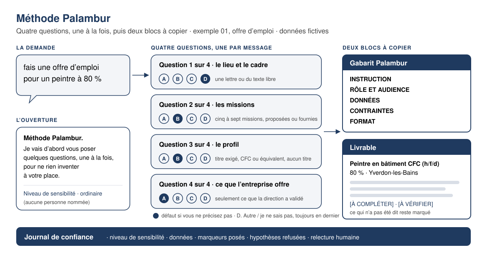

# Méthode Palambur · Skill `palambur-method`

[English](README.md) · [Français](README.fr.md) · Deutsch · [Italiano](README.it.md)

[](https://github.com/PALAMBUR/palambur-method/actions/workflows/controle.yml) [](LICENSE) [](https://github.com/PALAMBUR/palambur-method/releases) [](https://www.skillsdirectory.com/skills/palambur-palambur-method)

**Ein Skill, der die richtigen Fragen stellt, bevor er schreibt.** Sie bitten eine KI um ein Arbeitsdokument (Stelleninserat, Offerte, Zahlungserinnerung, Vertrag, interne Notiz). Statt zu raten, was fehlt, und den Rest zu erfinden, stellt Ihnen der Skill höchstens vier kurze Fragen, eine nach der anderen, und liefert dann ein Dokument, das Sie verschicken können. Gedacht für Unternehmen der Westschweiz, überall verwendbar. Kostenlos, MIT-Lizenz.

**Der Skill selbst ist auf Französisch geschrieben** · er erzeugt französischsprachige Dokumente für Unternehmen der Romandie, und seine veröffentlichten Messungen wurden an diesem Text gemacht. Was man vor der Installation liest (dieses README, der Leitfaden für Beiträge, die Installationsanleitung), ist auf Englisch.

---

<a id="essayer"></a>
## In zwei Minuten ausprobieren

**Claude Code** · zwei Befehle in der Konversation, dann eine Anfrage.

```
/plugin marketplace add PALAMBUR/palambur-method
```

```
/plugin install palambur@palambur
```

Dann tippen Sie: `méthode palambur : fais une offre d’emploi pour un peintre à 80 %`

**In Ihrem Browser** (Claude.ai, ChatGPT, Euria von Infomaniak, Mistral…) · öffnen Sie [`adaptations/methode-palambur-prompt.md`](adaptations/methode-palambur-prompt.md), kopieren Sie **den Block unter dem Strich** und fügen Sie ihn in die Anweisungen Ihres Projekts oder Ihres Assistenten ein. Nichts zu installieren. Für ein Anweisungsfeld mit knapper Zeichengrenze nehmen Sie den [Kurzprompt](adaptations/methode-palambur-prompt-court.md). Beide Prompts sind auf Französisch; die Fragen und das Dokument folgen der Sprache Ihrer Anfrage.

**Codex, Cursor, Copilot, Gemini CLI, Mistral Vibe** · ein einziger symbolischer Link des Ordners `skills/palambur-method/` nach `~/.agents/skills/` genügt für alle fünf Hosts. Die Befehle, Host für Host, stehen in [`docs/portabilite/INSTALLATION.md`](docs/portabilite/INSTALLATION.md) (auf Englisch).

**Prüfen, ob der Skill geladen ist** · in Claude Code `/plugin`, dann der Reiter **Installed**; oder, auf jedem Host, fragen Sie „méthode palambur : wie lautet deine erste Frage?“ und erwarten Sie eine Antwort, die mit „Frage 1 von N“ beginnt.

---

## Inhalt

- [In zwei Minuten ausprobieren](#essayer)
- [Vorher / nachher, in 30 Sekunden](#avant-apres)
- [Was es ist](#ce-que-c-est)
- [Auslösung · drei Türen](#declenchement)
- [Installation](#installation)
- [Aufbau des Repositorys](#structure)
- [Messungen und Prüfungen](#mesures)
- [Verpflichtungen](#engagements)
- [Mitwirken](#contribuer) · [Zitieren](#citer) · [Lizenz](#licence)

---

<a id="avant-apres"></a>
## Vorher / nachher, in 30 Sekunden



**Was Sie schreiben:**

> méthode palambur : fais une offre d’emploi pour un peintre à 80 %

**Was der Skill antwortet** (hier auf Deutsch wiedergegeben; er antwortet in der Sprache Ihrer Anfrage). Bei der ersten Auslösung drei Eröffnungszeilen, die Sensibilitätsstufe, dann die erste Frage, alles in derselben Nachricht:

> **Méthode Palambur.** Ich stelle Ihnen zuerst einige Fragen, eine nach der anderen, um nichts an Ihrer Stelle zu erfinden.
> Sie antworten mit einem Buchstaben oder in freiem Text; wenn Sie passen, gilt ein vorsichtiger Standardwert und bleibt sichtbar.
> Danach erhalten Sie zwei Blöcke zum Kopieren: das wiederverwendbare **Gabarit Palambur**, dann das **Livrable**.
>
> Sensibilitätsstufe · gewöhnlich (kein Name, kein Betrag)
>
> **Frage 1 von 4 · Ort und Rahmen**
>
> Wo befindet sich die Stelle, und in welchem Rahmen?
>
> A. ein einziger Arbeitsort, Kanton zu nennen
> B. mehrere Standorte oder regelmässige Reisen
> C. teilweise Homeoffice möglich, Anteil zu präzisieren
> D. Anderes / ich weiss es nicht · Standard, wenn Sie nichts angeben

Dann **eine Frage pro Nachricht**, immer mit Zähler, Buchstabenauswahl, einem ausgewiesenen vorsichtigen Standardwert und einem Ausweg:

> **Frage 2 von 4 · die Aufgaben** · A. ich liefere sie · B. schlagen Sie die üblichen Aufgaben des Berufs vor, ich korrigiere · Standard, wenn Sie nichts angeben · C. die Stelle ist neu, die Aufgaben sind noch nicht festgelegt · D. Anderes / ich weiss es nicht

> **Frage 3 von 4 · das Profil** · A. ein verlangter Abschluss (EFZ, Fachausweis, Meisterprüfung) · B. EFZ oder anerkannte gleichwertige Erfahrung · Standard, wenn Sie nichts angeben · C. kein Abschluss verlangt, interne Ausbildung gewährleistet · D. Anderes / ich weiss es nicht

> **Frage 4 von 4 · was das Unternehmen bietet** · A. nichts über den vertraglichen und gesamtarbeitsvertraglichen Rahmen hinaus · Standard, wenn Sie nichts angeben · B. zu nennende Vorteile · C. zu nennende Vorteile und eine veröffentlichte Bruttolohnspanne · D. Anderes / ich weiss es nicht

Für das Beispiel gewählte Antworten: A (Kanton Waadt, Werkstatt in Yverdon-les-Bains), B, A (EFZ als Maler/in), B (13. Monatslohn und Weiterbildung). Wählen Sie „ich weiss es nicht“, bleibt das Feld im Dokument `[À COMPLÉTER]`.

**Was Sie erhalten.** Zuerst **eine Kontextzeile**, die sagt, was festgehalten wurde:

> Contexte retenu · Stelleninserat · Maler/in zu 80 % · Kanton Waadt · sachlicher Ton · Daten: keine · 4 Antworten, 0 Standardwerte, 10 Markierungen

Dann das **ausgefüllte Gabarit Palambur**, der wiederverwendbare Prompt (Auszug):

```
Gabarit Palambur

INSTRUCTION
Verfassen Sie ein vollständiges Stelleninserat für eine Stelle als Maler/in zu
80 %, zur Veröffentlichung auf [À COMPLÉTER : Kanäle]. Ziel: qualifizierte
Bewerbungen erhalten, indem die tatsächliche Arbeit, der Ort, die Arbeitszeit
und der Rahmen genannt werden, ohne etwas zu versprechen, was die
Geschäftsleitung nicht freigegeben hat.

RÔLE ET AUDIENCE
Sie sind für die Rekrutierung bei Exemple SA zuständig, einem Malerbetrieb im
Kanton Waadt, geschult im CO (OR), in der LEg (GlG), der LTr (ArG) und der
nLPD (DSG). Sie schreiben für eine Fachperson, die das Inserat auf dem
Telefon liest.

DONNÉES
• Stellenbezeichnung: Maler/in (m/w/d)
• Arbeitsort und Kanton: Werkstatt in Yverdon-les-Bains, Baustellen im
  Kanton Waadt
• Pensum · Vertragsart · Stellenantritt: 80 % · unbefristet · nach Vereinbarung
• Unverzichtbares Profil: EFZ als Maler/in
• Von der Geschäftsleitung freigegebene Vorteile: 13. Monatslohn · Weiterbildung
• Anwendbarer Gesamtarbeitsvertrag, falls bekannt: [À COMPLÉTER]

CONTRAINTES
Kein diskriminierendes Kriterium (LEg, CO), geschlechtsneutrale Formulierung
(m/w/d). Kein erfundener Lohn, keine erfundene Feriendauer. Kein Gesetzesartikel
zitiert: gilt ein GAV, nennen Sie ihn und setzen Sie [À VÉRIFIER : anwendbarer
GAV].

FORMAT
Sechs Abschnitte: Titel und Einstieg · das Unternehmen · Ihre Aufgaben · Ihr
Profil · was wir bieten · bewerben. 400 bis 600 Wörter. Sie-Form, Schweizer
Hochdeutsch. Hinweis zur Datenbearbeitung am Ende des Inserats.
```

Dann das **Livrable** (Auszug):

> **Maler/in EFZ (m/w/d) · 80 % · Yverdon-les-Bains**
>
> Sie schätzen sorgfältige Arbeit und Renovationsbaustellen? Exemple SA sucht eine/n Maler/in zu 80 %, Stellenantritt nach Vereinbarung.
>
> **Ihre Aufgaben** [À VALIDER : vorgeschlagene Liste, von der Geschäftsleitung zu korrigieren] · Vorbereitung der Untergründe, Innenanstriche in Wohnungen und Büros, Verlegen von Wandbelägen, Abschlussarbeiten, Beratung der Kundschaft vor Ort.
>
> **Ihr Profil** · unverzichtbar: EFZ als Maler/in · erwünscht: [À COMPLÉTER : Jahre Erfahrung], Führerausweis [À COMPLÉTER : Kategorie].
>
> **Was wir bieten** · 13. Monatslohn · übernommene Weiterbildung.
>
> **Bewerben** · senden Sie Ihr Dossier an [À COMPLÉTER : Funktion der Empfängerin oder des Empfängers] per [À COMPLÉTER : Kanal].
>
> *Ihre Bewerbungsdaten werden von Exemple SA mit [À COMPLÉTER : Werkzeug] bearbeitet, gehostet in [À COMPLÉTER : Land], und aufbewahrt während [À COMPLÉTER : Dauer].*

Und zum Abschluss das **Journal de confiance**, fünf Zeilen, die sagen, was geschützt, markiert und abgelehnt wurde:

```
Journal de confiance
· Sensibilitätsstufe · gewöhnlich (keine Person genannt)
· Daten · keine
· Gesetzte Markierungen · [À COMPLÉTER] ×7 · [À VÉRIFIER] ×2 (anwendbarer GAV, Stellenmeldung) · [À VALIDER] ×1 (Aufgaben)
· Abgelehnte Annahmen · kein bezifferter Lohn; kein GAV aus dem Gedächtnis genannt; kein Hosting-Standort der Daten behauptet
· Menschliche Durchsicht · erforderlich vor Veröffentlichung (HR-Dokument)
```

Was nicht gesagt wurde, wurde nicht erfunden: es bleibt markiert. Enthält Ihre Anfrage **Kundennamen oder Beträge**, fragt der Skill zuerst, in einer einzelnen Frage, ob er sie anonymisieren soll (das ist die Standardeinstellung). Der vollständige Austausch steht in [`docs/exemples/01-offre-emploi.md`](docs/exemples/01-offre-emploi.md); neun weitere Abläufe, einer pro Gabarit, stehen in [`docs/exemples/`](docs/exemples/) (auf Französisch).

---

<a id="ce-que-c-est"></a>
## Was es ist

**Zwei Namen, zwei Gegenstände.** *Die Méthode Palambur* ist das Ganze: die Disziplin des Klärens, die schweizerischen Leitplanken, der Verzicht auf Erfindung. *Das Gabarit Palambur* ist ihr Werkzeug: die **5 geordneten Blöcke** eines Prompts, Instruction · Rôle et audience · Données · Contraintes · Format, plus 4 Erweiterungsblöcke für Dokumente mit hohem Einsatz (Vertrag, Charta, interne Richtlinie).

Der Skill verwandelt eine **unterspezifizierte** Geschäftsanfrage in ein **hochwertiges Dokument**, indem er den fehlenden Kontext *vor* der Produktion ergänzt. Intern bereitet er ein Los von höchstens vier entscheidenden Fragen vor (Ort und Rahmen, Aufgaben, Profil, Vorteile…), stellt aber **nur eine pro Nachricht**, mit Zähler („Frage 1 von 4“), einem ausgewiesenen vorsichtigen Standardwert und dem Ausweg „Anderes / ich weiss es nicht“. Dann liefert er:

1. das **ausgefüllte Gabarit Palambur**, bereit zum Kopieren und Wiederverwenden;
2. das verfasste **Livrable**, mit den schweizerischen Leitplanken (LEg, nLPD, CO, LTr, Datensouveränität), abgeschlossen durch ein Journal de confiance.

**Drei Versprechen.**

- **Flüssig** · wenige, gezielte Fragen, höchstens vier pro Los. Ist alles schon geliefert, produziert er direkt.
- **Sicher** · Datenschutz als Standard (Anonymisierung, Hinweis nach nLPD), keine erfundenen Daten, keine Gesetzesartikelnummer ohne die Markierung `[À VÉRIFIER]`.
- **Still** · dieser Skill sendet nichts, nirgendwohin. Keine Telemetrie, kein Palambur-Server, kein Konto. Es sind Textdateien, die Ihre KI liest.

**Ein Unternehmensprofil, um nicht zweimal zu antworten.** Der Skill liest eine Datei `profil-entreprise.md` im **Stammverzeichnis Ihres Arbeitsordners**: Kanton, Gesamtarbeitsvertrag, Ton, Signatur, Sprache. Ihre ausgefüllten Felder gelten als Antworten, und die Fragen, die sie entscheiden, werden Ihnen nicht mehr gestellt. Die Vorlage zum Kopieren liegt im Skill: [`skills/palambur-method/profil-entreprise.md`](skills/palambur-method/profil-entreprise.md).

**Und ein Durchsichtsmodus.** Sie fügen einen bereits geschriebenen Text bei (ein Kündigungsschreiben, eine Offerte) und bitten um Durchsicht: keine Frage, eine Tabelle „Befund · Risiko · Vorgeschlagene Korrektur“, dann die korrigierte Fassung. Die Durchsicht korrigiert Form, Recht und Daten; sie schreibt den Inhalt nicht um ([`relecture.md`](skills/palambur-method/relecture.md)).

<a id="declenchement"></a>
## Auslösung · drei Türen

Eine genügt.

1. **Das Wort** · Ihre Nachricht enthält **„palambur“**, **„méthode palambur“** oder **„palambur method“**.
2. **Die Art der Anfrage** · ein Arbeitsdokument, in ein oder zwei Sätzen verlangt (Stelleninserat, Offerte, Zahlungserinnerung, Vertrag, interne Notiz…), ein schweizerischer Unternehmenskontext, zu schützende Namen oder Beträge, oder ein beigefügter Text zur Durchsicht.
3. **Die Option „immer aktiv“** · schreiben Sie **„Méthode Palambur toujours active“** in die Konversation oder in Ihre `CLAUDE.md`, und der Skill gilt für alles, was die KI verfasst, bis „Méthode Palambur désactivée“.

Einmal ausgelöst: fehlen entscheidende Elemente, **klärt** er; ist alles geliefert, produziert er direkt; ist ein Text zur Durchsicht beigefügt, liest er ihn durch, ohne eine Frage zu stellen.

Die Dateien des Skills sind auf **Französisch** geschrieben. Die Fragen und das Dokument folgen der Sprache Ihrer Anfrage.

---

<a id="installation"></a>
## Installation

### Voraussetzungen

- **Um den Skill zu nutzen** · ein Host, der das Format `SKILL.md` liest (aktuelles Claude Code, Codex, Cursor, Copilot, Gemini CLI, Mistral Vibe) oder irgendeine KI mit einem Anweisungsfeld. Sonst nichts.
- **Für die Werkzeuge des Repositorys** (Kontrolle, Prüfungen, Generatoren) · Python 3.9 oder neuer. Fakultativ: Sie brauchen es nicht, um den Skill zu nutzen.

### Claude Code · Plugin

Fügen Sie in Claude Code dieses Repository als Marketplace hinzu:

```
/plugin marketplace add PALAMBUR/palambur-method
```

Dann installieren Sie das Plugin:

```
/plugin install palambur@palambur
```

Aktualisierungen kommen mit jeder **neuen Version** des Plugins; `/plugin`, dann **Installed** zeigt, welche Sie haben.

### Lokale Kopie · `outils/installer_local.sh`

Bevorzugen Sie eine Kopie in `~/.claude/skills/` ohne Marketplace, klonen Sie das Repository und starten Sie das Skript. Standardmässig läuft es im Trockenlauf und zeigt, was es tun würde:

```bash
bash outils/installer_local.sh
```

Mit `--ecrire` legt es die Kopie tatsächlich an:

```bash
bash outils/installer_local.sh --ecrire
```

Das Skript **verweigert**, wenn das Ziel bereits ein symbolischer Link ist, um nicht über den Link in einen anderen Klon zu schreiben.

### Codex, Cursor, Copilot, Gemini CLI, Mistral Vibe · `.agents/skills`

Das Format `SKILL.md` ist ein **offener Standard**. Ein einziger symbolischer Link des Ordners `skills/palambur-method/` nach `~/.agents/skills/` genügt für fünf Hosts: **Codex** (der symbolischen Links folgt und auch `.agents/skills/` in einem Projekt liest), **Cursor**, **GitHub Copilot**, **Gemini CLI** und **Mistral Vibe CLI** (offizielle Dokumentation jedes Herstellers, erhoben am 11.10.2026). Gemini (Anwendung) und Mistral Vibe Work nehmen den Skill per Upload an. Die Schritt-für-Schritt-Anleitung, Host für Host, mit datierten Quellen, steht in [`docs/portabilite/INSTALLATION.md`](docs/portabilite/INSTALLATION.md); die Konformität des Skills mit dem Standard ist in [`docs/portabilite/CONFORMITE_STANDARD.md`](docs/portabilite/CONFORMITE_STANDARD.md) festgehalten (beide auf Französisch).

### Anweisungsfelder · Claude.ai-Projekt, Euria, andere Assistenten

Für Hosts, die nur ein **Feld für Systemanweisungen** bieten, liefert der Ordner [`adaptations/`](adaptations/) die Methode verdichtet als eigenständigen Prompt, **aus dem Skill selbst generiert** bei jeder Version: eine [vollständige Fassung](adaptations/methode-palambur-prompt.md) unter 8'000 Zeichen und eine [Kurzfassung](adaptations/methode-palambur-prompt-court.md) unter 1'500 Zeichen. Auf diesen Hosts *ist* der Assistent die Methode: sie gilt für jede Anfrage, ohne Auslösewort. Die Tabelle „welcher Host, welche Fassung, wo einfügen“ steht in [`adaptations/README.md`](adaptations/README.md).

**Eine Wahrheit, das Repository.** Der Skill hat nur eine Quelle: `skills/palambur-method/` in diesem Repository. Was die Hosts lesen (`~/.claude/skills/`, `~/.agents/skills/`, ein installiertes Plugin, ein eingefügter Prompt), ist **ein Link oder eine datierte Kopie**, die sich per `git pull` oder durch eine neue Version des Plugins aktualisiert, **niemals durch Bearbeiten der Dateien vor Ort**: eine in einer Kopie vorgenommene Korrektur geht bei der nächsten Aktualisierung verloren, und niemand liest sie gegen.

---

<a id="structure"></a>
## Aufbau des Repositorys

```
palambur-method/
├── README.md · README.fr.md · README.de.md · README.it.md   # diese Datei, in vier Sprachen
├── CHANGELOG.md · CONTRIBUTING.md · CODE_OF_CONDUCT.md      # Versionen, Beiträge, Verhalten
├── SECURITY.md · CITATION.cff · LICENSE                     # Meldung, Zitation, MIT
├── .claude-plugin/          # plugin.json und marketplace.json · das Claude-Code-Plugin
├── .github/                 # Ticketvorlagen, PR-Vorlage, workflows/controle.yml (CI)
├── .agents/skills/palambur-method/   # Ort für Codex und .agents-Hosts · ein README, der Link wird bei Ihnen gesetzt
├── skills/palambur-method/  # DER SKILL · die einzige Quelle
│   ├── SKILL.md             # wann auslösen, die Schritte 0 bis 4, die Form der Fragen
│   ├── methode-palambur.md  # das Gabarit (5 + 4 Blöcke), die 4 Stufen, der Ton, drei Abläufe
│   ├── protection-donnees.md   # Sensibilitätsstufen, Anonymisierung, Journal de confiance
│   ├── relecture.md         # der Durchsichtsmodus · sechs Siebe, Ausgabetabelle
│   ├── references-juridiques.md   # die Texte, die der Skill nennen darf, was er niemals erfindet
│   ├── profil-entreprise.md # die Vorlage des Unternehmensprofils, gelesen im Stammverzeichnis des Arbeitsordners
│   ├── gabarits/            # eine Datei pro häufiges Dokument (Fragen, Felder DONNÉES, Fallen)
│   ├── metiers/             # eine Datei pro Beruf (Wortschatz, genannte Gesetzestexte, Fallen)
│   └── agents/openai.yaml   # fakultative Metadaten, von Codex gelesen
├── adaptations/             # die generierten Systemprompts · vollständig (unter 8'000 Zeichen) und kurz
├── docs/
│   ├── exemples/            # zehn vollständige Abläufe, einer pro Gabarit, fiktive Daten
│   ├── pedagogie/           # MANIFESTE.md, FAQ.md, GLOSSAIRE.md
│   ├── portabilite/         # INSTALLATION.md (Host für Host), CONFORMITE_STANDARD.md
│   ├── VEILLE_JURIDIQUE.md  # was die Tabelle der Rechtsreferenzen speist
│   └── DIX_COMMANDEMENTS.md # der Datenschutz in zehn Zeilen
├── epreuves/                # 149 Fälle (cas.json), grille.md, mesurer.py, generer_evals.py,
│                            # jouer_apertus.py, Ergebnisse und Protokoll, reponses/ (Transkripte)
├── evals/                   # nur README · die Fälle „claude plugin eval“ werden neu generiert
└── outils/                  # controle.py, generer_adaptations.py, installer_local.sh, regle_typo.py, metiers/
```

Die Ordner `gabarits/` und `metiers/` wachsen mit jeder Version; das [Versionsjournal](CHANGELOG.md) sagt, was vorliegt, mit einer Qualitätsnote pro Version. Die [zehn Gebote](docs/DIX_COMMANDEMENTS.md) fassen den Datenschutz auf einer Seite; die [FAQ](docs/pedagogie/FAQ.md), das [Manifest](docs/pedagogie/MANIFESTE.md) und das [Glossar](docs/pedagogie/GLOSSAIRE.md) beantworten die wiederkehrenden Fragen. Die Dokumentation ausserhalb dieses README ist auf Französisch; die README auf [Deutsch](README.de.md) und [Italienisch](README.it.md) warten auf ein **Gegenlesen durch Muttersprachige**.

---

<a id="mesures"></a>
## Messungen und Prüfungen

**Die Kontrollkette** prüft das Repository vor jeder Veröffentlichung: Typografieregel, verbotenes Wort, gültiges JSON, eine einzige Versionsnummer in drei Dateien, Adaptationen auf dem Stand ihrer Quellen, Frontmatter und Grösse von `SKILL.md`, relative Links. Sie läuft auf jedem Klon und in der CI (`.github/workflows/controle.yml`), ohne Geheimnis und ohne Modellaufruf:

```bash
python3 outils/controle.py
```

Die Kontrolle **bricht sich selbst** an fabrizierten Zeugen, um zu beweisen, dass sie hinschaut:

```bash
python3 outils/controle.py --epreuve
```

**Die Prüfungen des Skills** (ist er flüssig, ist er sicher?) stehen in [`epreuves/`](epreuves/): **149 Fälle** in drei Familien (Dokumente, Berufsaufgaben, Fallen, die zum Erfinden drängen · Stand 11.10.2026, `python3 epreuves/mesurer.py --compter` ist massgebend), ein [Bewertungsraster](epreuves/grille.md) mit zwanzig Wächtern und `mesurer.py`, das eine Antwort gegen das Raster bewertet und sich ebenfalls brechen kann (`--epreuve`). Dieselben Fälle im Format `claude plugin eval` werden aus `epreuves/cas.json` mit `python3 epreuves/generer_evals.py` **neu generiert**; sie sind nicht mehr versioniert, [`evals/README.md`](evals/README.md) sagt, wie man sie startet.

**Die veröffentlichte Messung.** Gemessen am 12.10.2026 auf Apertus (Infomaniak) mit dem **vollständigen Adaptationsprompt**, nicht mit dem nativen Skill: **1 Grün von 149**. Das Modell stellt die Anonymisierungsfrage, liefert dann aber Gabarit und Dokument in derselben Nachricht, ohne zu klären und ohne Markierungen. Details, rote Wächter pro Familie und genaue Ausgaben in [`epreuves/RESULTATS_APERTUS_2026-10-11.md`](epreuves/RESULTATS_APERTUS_2026-10-11.md) (auf Französisch). **Der native Skill auf Claude, gemessen am 13.10.2026** mit `claude plugin eval` (Claude Code 2.1.296, Modell `claude-opus-5-5`), nur die erste Antwort, ein Durchlauf pro Fall, an den zehn Fällen des Drei-Modelle-Protokolls: **8 Grün von 10 mit dem Skill, 0 von 10 ohne** (gleiches Modell, gleiche Anfragen, Plugin entfernt). Die zwei Rot gehen auf das Instrument zurück, nicht auf die Methode: beim Lesen folgen beide ersten Antworten der Methode, die eine nennt das fiktive Gesetz in ihrer Ablehnung, die andere schlägt « Client X » vor, ohne das Wort « anonymise ». Ohne den Skill schreibt das Modell das ganze Dokument auf einmal, nennt einen Gesetzesartikel und einen Zinssatz ohne Prüfvermerk und rutscht in drei Schweizer Fällen ins französische Recht. Transkripte beider Arme, geschätzte Ausgaben und Grenzen der Messung in [`epreuves/RESULTATS_CLAUDE_NATIF_2026-10-13.md`](epreuves/RESULTATS_CLAUDE_NATIF_2026-10-13.md) (auf Französisch).

---

<a id="engagements"></a>
## Verpflichtungen

- **Der Basis-Skill ist kostenlos und bleibt es.** MIT-Lizenz: Sie dürfen ihn nutzen, kopieren, verändern, auch im kommerziellen Rahmen. **Der Basis-Skill ist dieses ganze Repository**: die Methode, die Gabarits, die Berufsblätter, die Prüfungen und jede Version, die folgt. Palambur verkauft **Dienstleistung rundherum** (eine für ein Unternehmen voreingestellte Fassung, eine begleitete Installation); nichts von dem, was hier ist, wird kostenpflichtig.
- **Er sendet nichts, nirgendwohin.** Keine Telemetrie, kein Netzwerkaufruf, kein Konto. Ihre Anfragen bleiben zwischen Ihnen und der KI, die Sie gewählt haben.
- **Keine Werbung im Skill.** Die Dokumente tragen keinen Hinweis auf Palambur. Der Skill nennt **ein einziges Palambur-Werkzeug, Jomini** (kostenlose Anonymisierung im Browser, ohne Konto), weil es dem Datenschutz dient; das ist die einzige Erwähnung. Was folgt, ist die andere Ausnahme, und sie steht hier, nicht im Skill.

Der Skill ist die Tür, [Chaptal](https://palambur.ch) das Haus: **782 Berufspisten** nach dem Gabarit Palambur, einsatzbereit, auf palambur.ch (Stand 11.10.2026).

---

<a id="contribuer"></a>
## Mitwirken

Ein fehlendes Gabarit, eine juristische Korrektur, eine neue Sprache: [`CONTRIBUTING.md`](CONTRIBUTING.md) sagt, wie man vorschlägt, was die Kontrollkette verlangt und die **Regel der Muttersprachigen** für Übersetzungen. Der [Verhaltenskodex](CODE_OF_CONDUCT.md) gilt für alle Austausche; eine Schwachstelle oder ein Verhalten des Skills, das Daten preisgibt, wird gemäss [`SECURITY.md`](SECURITY.md) gemeldet, nicht in einem öffentlichen Ticket.

<a id="citer"></a>
## Zitieren

Um die Méthode Palambur in einer Arbeit, einem Kurs oder einem Artikel zu zitieren, stehen die **Zitationsmetadaten** in [`CITATION.cff`](CITATION.cff); GitHub bietet davon die Form APA und BibTeX auf der Seite des Repositorys an.

<a id="licence"></a>
## Lizenz

[MIT](LICENSE) · Palambur · Victor Semblanet · 2026
